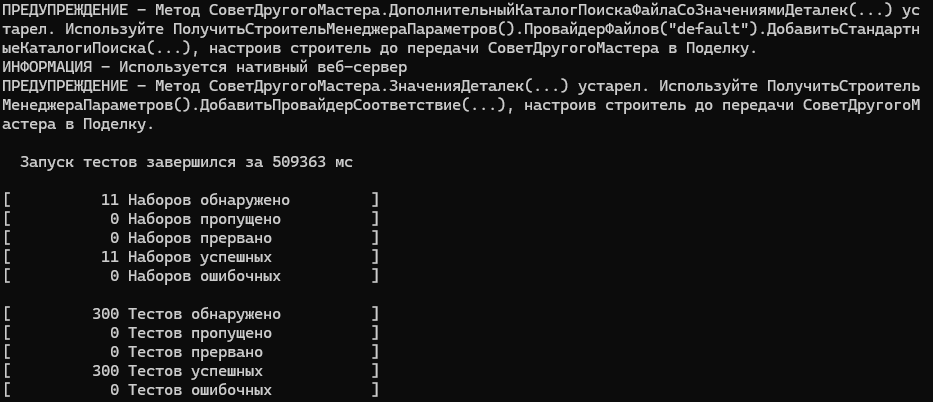

# Тестирование open-source проекта: winow

## Выбранный проект

- Ссылка: https://github.com/autumn-library/winow
- Описание: минималистичный веб-сервер на нативном OneScript (язык 1С).
  Поддерживает маршрутизацию, куки, сессии, шаблоны, WebSocket, SSE,
  OpenTelemetry и генерацию OpenAPI.
- Почему выбран: стек 1С/OneScript, проект активно развивается (свежие
  релизы и коммиты), есть тесты и CI.

## Окружение

- ОС: Windows, OneScript 2.2.1, opm 1.7.1
- Fork: https://github.com/Im-Egor/winow
- Коммит, на котором снята метрика «до»: `b9df68b72d42a77b649d205e7910d91896fd31de`
- Установка зависимостей: `opm install -l --dev`

## Запуск тестов и измерение покрытия

```
oneunit execute --mode summary --genericCoverage out/genericCoverage.xml --cobertura out/cobertura.xml --junit out/junit.xml
```

Прогон тестов из папки `tests` без e2e (они требуют Docker). Покрытие
считается встроенным механизмом oneunit и пакетом `coverage`, отчёты в
форматах GenericCoverage и Cobertura (как в CI проекта). Результат до
изменений: 297 тестов, все успешны, время около 504 с.

## Покрытие тестами

| Метрика | До | После |
|---|---|---|
| Строк кода в `src` | 3827 | 3827 |
| Покрыто строк | 3594 | 3608 |
| Общее покрытие | 93,91% | 94,28% |
| `ХттпОтвет.os` | 25 из 39 (64,1%) | 39 из 39 (100%) |
| Тестов, все успешны | 297 | 300 |

Вывод полного прогона до изменений:


Вывод полного прогона после добавления тестов:


Слабо покрытые файлы по отчёту «до»: `ХттпОтвет` (64,1%),
`БрокерСообщенийСобытийСервера` (64,5%), `НативныйОбработчикЗапросов`
(76,7%), `ШифрованиеВебСокета` (81,5%). Для работы выбран `ХттпОтвет`:
небольшой класс с чистой логикой, который проверяется без запуска сервера.

## Покрытый функционал

Файл `tests/ХттпОтвет.os`, три unit-теста класса `ХттпОтвет`, методы
которого не выполнял ни один тест:

1. `Заголовок` — запись заголовков, возврат самого объекта (цепочка
   вызовов), накопление нескольких заголовков.
2. `ТелоИзСтроки` — кодирование строки с кириллицей в UTF-8, размер тела
   (20 байт), побайтовое сравнение с эталонным буфером.
3. `ТелоИзФайла` — чтение файла в буфер, размер и побайтовое сравнение
   с эталоном. Путь к тестовому файлу строится от каталога теста.

## Технологии и библиотеки

- OneScript 2.2.1 и менеджер пакетов opm
- oneunit — фреймворк тестирования (аннотации `&Тест`, структура
  «Дано / Когда / Тогда»)
- asserts — проверки `Ожидаем.Что(...)`
- coverage — измерение покрытия (форматы Cobertura и GenericCoverage)
- Git, GitHub, CodeRabbit (автоматическое ревью PR)

## Выводы

- Общий процент покрытия (93,91%) скрывал слабые места: по файлам он
  колебался от 64% (`ХттпОтвет.os`) и выше. Искать, что тестировать,
  пришлось по отчёту Cobertura, а не по итоговому числу.
- Три тестовые процедуры в `alltest.os` не запускаются: у них нет аннотации
  `&Тест` (это подтвердил `oneunit discover`). Часть непокрытых строк
  в `ШифрованиеВебСокета.os` похожа на мёртвый код, так что 100% там не цель.
- Покрытие показывает, что код выполнялся, но не что он проверен, поэтому
  тесты проверяют конкретные свойства: возврат самого объекта, размер тела
  и побайтовое совпадение с эталоном.
- Ревьюер (CodeRabbit) нашёл реальную хрупкость: относительный путь к файлу
  в тесте. Она исправлена в коммите `21b4f82`.

## Pull Request

https://github.com/autumn-library/winow/pull/163

Статус: замечание CodeRabbit исправлено; основные CI-проверки проекта
ожидают одобрения мейнтейнера.