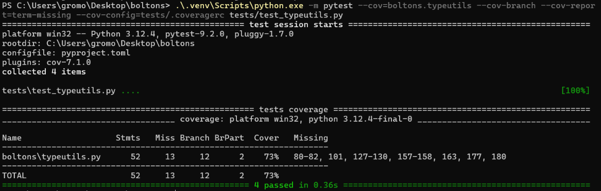
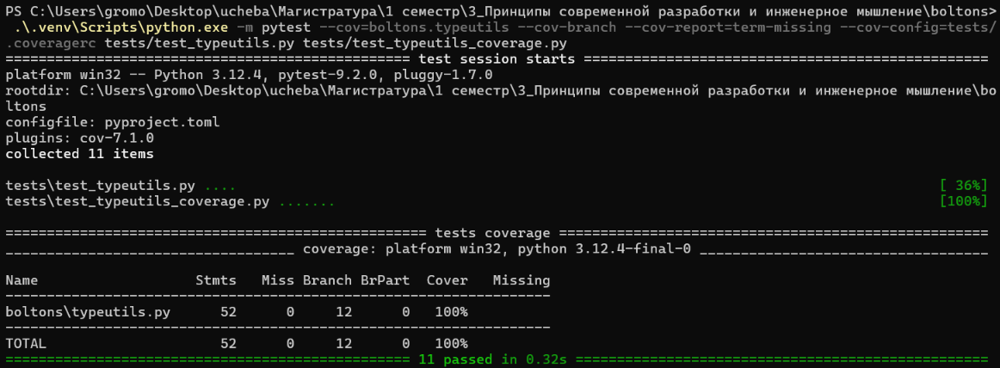

# Отчет по лабораторной работе №2
## Тестирование open-source проекта

Выполнил(а): **Громова Эльвира**  
Группа: **РИЗМ-161207**

### 1. Выбранный проект

Ссылка: https://github.com/mahmoud/boltons  

Boltons — библиотека на Python с дополнительными утилитами, которых нет в стандартной библиотеке.

Стек: Python, pytest, pytest-cov.

### 2. Покрытие тестами (до и после)

Для работы был выбран модуль typeutils.

| | До | После |
|---|---|---|
| Coverage | **73%** | **100%** |

Скриншот до:

Скриншот после:

### 3. Что покрыла своими тестами

По результатам coverage в модуле typeutils часть кода не была покрыта тестами. Для этих участков я добавила файл tests/test_typeutils_coverage.py с 7 тестами.

**1. make_sentinel**

Функция создаёт специальный объект-маркер. Его используют, когда нужно обозначить отсутствие значения, но None для этого не подходит.

В тестах проверено:
- как объект отображается при печати;
- отображение имени, если оно задано;
- появление ошибки ValueError, если такой объект создаётся неправильно.

**2. issubclass**

Функция проверяет, является ли один класс наследником другого.

В стандартном Python при передаче не классов возникает ошибка.  
В boltons в этом случае возвращается False.

В тесте проверено, что на некорректных аргументах функция не завершает работу с ошибкой, а возвращает False.

**3. get_all_subclasses**

Функция возвращает список всех классов-наследников.

В тестах проверено:
- при передаче не класса возникает ошибка TypeError;
- при сложном наследовании один и тот же класс не дублируется в результате.

**4. classproperty**

Это свойство, относящееся ко всему классу, а не к отдельному экземпляру.

В тесте проверено, что значение доступно и через класс, и через экземпляр.

### 4. Технологии и библиотеки для тестирования

- Python 3.12
- pytest — запуск unit-тестов
- pytest-cov — измерение coverage (в том числе branch coverage)
- coverage.py — библиотека, на которой работает pytest-cov

### 5. Ссылка на Pull Request

https://github.com/mahmoud/boltons/pull/825  

Fork: https://github.com/grmvlvr/boltons  
