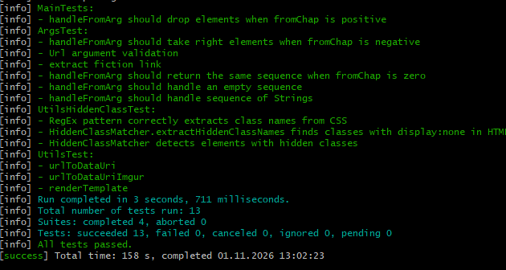
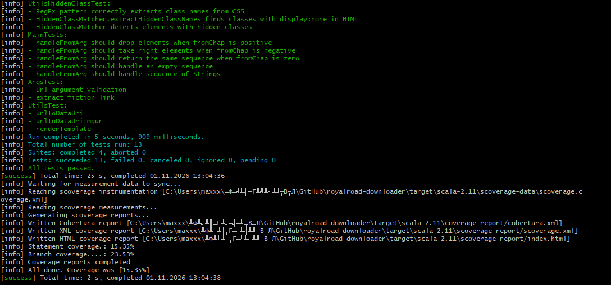
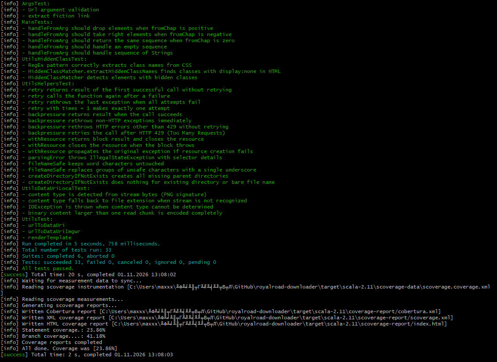
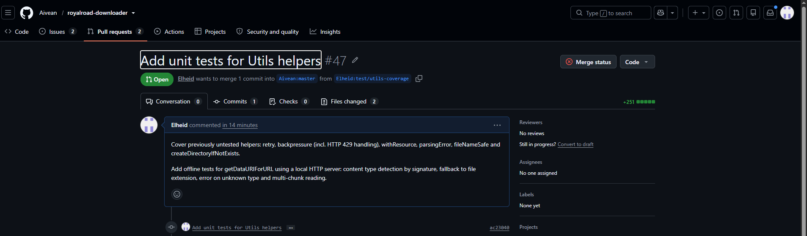

# Практика 102. Тестирование open-source проекта

**Студент:** Комаров Максим Сергеевич (GitHub: [Elheid](https://github.com/Elheid))

## 1. Выбранный проект

- **Репозиторий:** https://github.com/Aivean/royalroad-downloader
- **Fork:** https://github.com/Elheid/royalroad-downloader
- **Описание:** консольная утилита, которая скачивает произведения с Royal Road и
  сохраняет их одним HTML-файлом. 
  Умеет скачивать диапазон глав, встраивать изображения как data URI и удалять скрытые
  «предупреждения о краже» из текста глав.
- **Стек:** Scala 2.11.11, sbt 1.1.6, scala-scraper 1.2.1 (jsoup), Scallop (разбор аргументов CLI), JDK 8.

**Материалы для контрибьюшена.** `CONTRIBUTING.md` в проекте нет. В `README.md` описаны сборка
(`sbt/sbt assembly`) и запуск (`sbt/sbt 'run …'`), а также указано, что сборка проверялась только
на Java 8. CI в GitHub Actions (`.github/workflows/test.yml`) выполняет `sbt/sbt clean test` на JDK 8,
по нему и сверялся порядок сборки и тестирования.

## 2. Настройка локального окружения

Окружение: Windows, терминал MSYS2 (UCRT64).

| Проблема | Причина | Решение |
|---|---|---|
| `Unrecognized VM option 'CMSClassUnloadingEnabled'` | в системе стояла Java 23, а скрипт `sbt/sbt` передаёт JVM опции, удалённые в Java 14+; Scala 2.11 на новых JDK тоже не компилируется | установлен Temurin JDK 8 (`winget install EclipseAdoptium.Temurin.8.JDK`), `JAVA_HOME`/`PATH` переключаются только в терминале сборки |
| `SSLException: Connection reset` для `repo.scala-sbt.org` и `repo.typesafe.com` | эти репозитории были недоступны из моей сети; плагин `sbt-assembly 0.14.7` есть только там | sbt настроен работать только с Maven Central (`~/.sbt/repositories` + `-Dsbt.override.build.repos=true`); `sbt-assembly` временно закомментирован в `project/plugins.sbt` и `build.sbt`, для тестов он не нужен. **Эти локальные правки в PR не входят.** |

Команда запуска sbt после настройки:
```
java -Xms512M -Xmx1536M -Xss1M -Dfile.encoding=UTF-8 -Dsbt.override.build.repos=true -jar sbt/sbt-launch.jar <команды>
```

## 3. Запуск проекта и существующих тестов

```
sbt clean test
sbt "run --help"
```
Существующие тесты: `ArgsTest`, `MainTests`, `UtilsTest`, `UtilsHiddenClassTest`, всего **13 тестов,
все проходят** (скриншот 1). Два теста в `UtilsTest` (`urlToDataUri`, `urlToDataUriImgur`) скачивают
картинки с github.com и i.imgur.com, то есть зависят от доступа в интернет.



## 4. Покрытие кода тестами

Покрытие измерялось плагином **sbt-scoverage 1.5.1**. Он подключён глобально
(`~/.sbt/1.0/plugins/scoverage.sbt`), чтобы не менять сборку проекта:
```
sbt clean coverage test coverageReport
```

| | Statement coverage | Branch coverage |
|---|---|---|
| **До** (`master`) | 15.35 % | 23.53 % |
| **После** (ветка `test/utils-coverage`) | 23.86 % | 41.18 % |
| **Прирост** | +8.51 п.п. | +17.65 п.п. |

| Файл | Statement до | Statement после |
|---|---|---|
| `Utils.scala` | TODO % | TODO % |
| `Main.scala` | TODO % | TODO % (не менялся) |

Общий прирост выглядит небольшим, потому что большую часть кода составляет `Main.scala`
(`object Main extends App` с сетевыми запросами к сайту). Unit-тестами без сети он не покрывается,
поэтому работа была сосредоточена на `Utils.scala`.





## 5. Написанные тесты (20 шт.)

**`UtilsHelpersTest.scala`** (16 тестов):
- `retry`: успех с первой попытки без повторов; успех после нескольких ошибок; проброс последнего
  исключения после исчерпания попыток; `times = 1` даёт ровно одну попытку;
- `backpressure`: возврат результата; немедленный проброс обычных исключений и HTTP-ошибок,
  кроме 429 (например, 404), без повторов; повтор вызова после HTTP 429;
- `withResource`: ресурс закрывается и при успехе, и при исключении в блоке; если ресурс не удалось
  создать, пробрасывается исходное исключение, а блок не вызывается;
- `parsingError`: тип исключения и наличие в сообщении имени, CSS-селектора и URL;
- `fileNameSafe`: допустимые символы сохраняются, группы недопустимых заменяются одним `_`;
- `createDirectoryIfNotExists`: создаются все родительские каталоги (а сам файл нет); нет ошибки,
  если каталог существует или путь без каталога.

**`UtilsDataUriLocalTest.scala`** (4 теста) — `getDataURIForURL` **без внешней сети**. На каждый
тест поднимается локальный HTTP-сервер (`com.sun.net.httpserver.HttpServer`) на случайном порту:
- тип определяется по сигнатуре PNG, результат совпадает с эталонным data URI;
- если сигнатура не распознана, тип берётся по расширению `.jpg/.png/.gif`;
- при неизвестном типе выбрасывается `IOException`;
- содержимое больше одного блока чтения (4 КБ) кодируется полностью и без искажений.

Итог прогона на ветке: **33 теста, 0 падений** (скриншот 3).

## 6. Используемые технологии и библиотеки для тестирования

- **ScalaTest 3.0.5** (`FunSuite`, `assert`, `intercept`) — тестовый фреймворк проекта;
- **sbt-scoverage 1.5.1** — измерение покрытия (statement и branch coverage, HTML-отчёт);
- `com.sun.net.httpserver.HttpServer` (входит в JDK) — локальный HTTP-сервер для изоляции от сети;
- `java.nio.file.Files.createTempDirectory` — временные каталоги для файловых тестов;
- `java.util.concurrent.atomic.AtomicInteger` — счётчики вызовов для проверки числа попыток.

## 7. Pull Request

- Ветка: `test/utils-coverage` (1 коммит «Add unit tests for Utils helpers»)
- PR в исходный репозиторий: TODO https://github.com/Aivean/royalroad-downloader/pull/47


